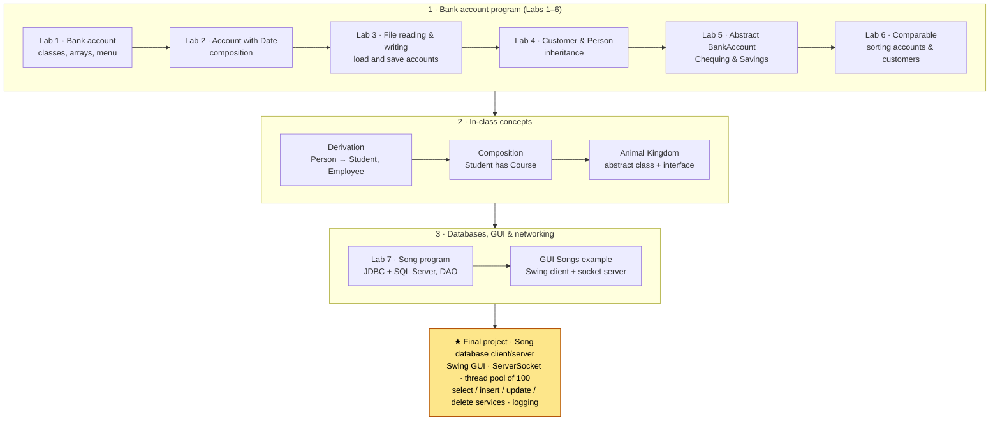

# Programming Concepts – Java (COMP 233)

My Java coursework from COMP 233, Semester 2 of the Business Information Systems program at Saskatchewan Polytechnic, Regina. The labs build one banking program step by step, from a single class to file handling, inheritance, abstract classes and sorting. The course then moves on to databases, a GUI client/server example and a final project: a multi-threaded Java client/server application for a SQL Server song database.

**Author:** Md Alamgir Hossain, PMP, CSM, ITIL v5 · [LinkedIn](https://www.linkedin.com/in/alamgircanb) · [pmport.ca](https://pmport.ca)

## Repository structure

```text
ProgrammingConceptGit/
├── labs/            Graded labs 1–7 (my own work)
├── in-class/        In-class exercises and the instructor's GUI songs example
└── final-project/   ★ Final project – multi-threaded song database client/server
```

| Folder | What's inside |
| --- | --- |
| `labs/` | Labs 1–7. Labs 1–6 grow the same bank account program; Lab 7 connects to a database |
| `in-class/` | Short in-class programs on inheritance, composition, interfaces and a GUI client/server |
| `final-project/` | The submitted final project, my drafts, the class walkthrough and the instructor's starter code |

Some labs keep two versions: `submitted` is what I handed in, and `revised` is the version I updated after the instructor's comments.

## Course map



Interactive repository diagram: [view on GitDiagram](https://gitdiagram.com/hossain8078/programmingconceptgit)

---

## At a glance

| # | Project | Main concept | Folder |
| --- | --- | --- | --- |
| 1 | Bank account | Classes, objects, arrays, console menu | [labs/lab-1-bank-account](labs/lab-1-bank-account) |
| 2 | Bank account with Date | Composition (an account has a Date) | [labs/lab-2-bank-account-with-date](labs/lab-2-bank-account-with-date) |
| 3 | File reading and writing | Loading and saving accounts to a text file | [labs/lab-3-file-reading-writing](labs/lab-3-file-reading-writing) |
| 4 | Customer and Person | Inheritance (`Customer extends Person`) | [labs/lab-4-customer-person-inheritance](labs/lab-4-customer-person-inheritance) |
| 5 | Chequing and Savings | Abstract class and method overriding | [labs/lab-5-abstract-accounts](labs/lab-5-abstract-accounts) |
| 6 | Sorting accounts | `Comparable` and `compareTo` | [labs/lab-6-comparable-sorting](labs/lab-6-comparable-sorting) |
| 7 | Song program | JDBC, SQL Server, DAO pattern | [labs/lab-7-song-database](labs/lab-7-song-database) |
| ★ | Final project | Client/server, threads, Swing GUI, SQL CRUD | [final-project/submitted](final-project/submitted) |

## Labs

### Lab 1 – Bank account

A console program that stores five bank accounts in an array and shows a menu: display all accounts, look up, edit, deposit, withdraw and transfer by account number.

- `submitted/` – the version I handed in, with the UML at the top of the driver.
- `revised/` – updated after the instructor's comments (for example, the `Scanner` and accounts array were made static).

### Lab 2 – Bank account with Date

Adds a `Date` class, so each account stores its last transaction date as an object instead of a string. This is composition: a `BankAccount` *has a* `Date`.

- `submitted/` and `revised/` as in Lab 1. The revised version only differs in the driver.

### Lab 3 – File reading and writing

Adds a `FileHandler` class. Accounts are read from a text file when the program starts, and the menu gains **Add New Account** and **Exit and Save**, which writes the accounts back to `233BankAccountTestData.txt`.

### Lab 4 – Customer and Person (inheritance)

Introduces `Person` and `Customer extends Person`, so account holder details move out of `BankAccount` into a customer object. File handling from Lab 3 is kept.

### Lab 5 – Abstract accounts

`BankAccount` becomes an abstract class with an abstract `withdraw` method. `ChequingAccount` and `SavingsAccount` extend it and each override `withdraw` with their own rules. The menu adds customer lookups and interest calculation.

### Lab 6 – Sorting with Comparable

`BankAccount` and `Customer` implement `Comparable` with their own `compareTo`, so the driver can sort them with `Arrays.sort` before displaying accounts and customers.

### Lab 7 – Song database

Connects to a SQL Server `Songs` database with JDBC. A `SongDAO` class keeps the SQL separate from the menu, which can display all songs and get, update or delete a song by ID.

## In-class exercises

| Folder | What it shows |
| --- | --- |
| [in-class/derivation](in-class/derivation) | Inheritance: `Student` and `Employee` extend `Person` |
| [in-class/composition](in-class/composition) | Composition: a `Student` holds `Course` objects |
| [in-class/animal-kingdom-interfaces](in-class/animal-kingdom-interfaces) | An abstract `Animal` class and a `Noisy` interface implemented by `Dog`, `Cat` and `Fish` |
| [in-class/gui-songs-client-server](in-class/gui-songs-client-server) | The instructor's example: a Swing GUI client and a socket server for the songs database |

## ★ Final project – Song database client/server

**Folder:** [final-project/submitted](final-project/submitted)

A client/server application for the SQL Server `Songs` database.

- **Server.** A `ServerSocket` accepts connections and hands each request to a fixed thread pool of 100 threads (`ExecutorService`).
- **Processing.** `ProcessSQL` (a `Runnable`) reads the request and passes it to the matching service: `SQLSelectService`, `SQLInsertService`, `SQLUpdateService` or `SQLDeleteService`, which all extend `Service`.
- **Data access.** `SongDAO` runs the SQL, and `Song` is the data object sent between client and server with object streams.
- **Client.** A Swing `GUIClient` with Lookup, Insert, Update and Delete buttons. The `Client` class handles the socket connection to the server for the GUI.
- **Logging.** `LoggerUtil` records server activity.
- The `Songs` table uses an `IDENTITY` column, so inserts leave out the ID.

| Folder | Contents |
| --- | --- |
| `final-project/submitted/` | The version I submitted, plus the submitted `.zip` |
| `final-project/drafts/draft-with-comments/` | An earlier draft with detailed comments, before the separate `Client` connection class was added |
| `final-project/drafts/draft-without-comments/` | A shorter draft without the detailed comments |
| `final-project/class-walkthrough/` | The version built step by step with the instructor in class |
| `final-project/instructor-starter/` | The instructor's starter code (`Client`, `GUIClient`, `Song`, `SongDAO`) |

## How to run

Only the `src` folders are in this repository (no NetBeans project files).

1. In NetBeans, create a new **Java with Ant → Java Application** project without a main class.
2. Copy the `src` folder of the program you want into the project, replacing the empty one.
3. Run the class with the `main` method, for example `BankAccountDriver` for the bank labs.

Lab 7, the GUI songs example and the final project also need:

- SQL Server running on `localhost:1434` with a `Songs` database.
- The Microsoft JDBC driver for SQL Server added to the project libraries.
- For the client/server programs, start the server first, then the client.

## Skills demonstrated

- **Object-oriented programming:** classes, objects, encapsulation, constructors, composition, inheritance, abstract classes, interfaces, polymorphism
- **Collections and sorting:** arrays, `ArrayList`, `Comparable`
- **File I/O:** reading and writing text files
- **Databases:** JDBC, SQL Server, the DAO pattern, CRUD operations
- **Networking and concurrency:** sockets, object streams, `ExecutorService` thread pools
- **GUI:** Java Swing forms in NetBeans

## Tools

Java · NetBeans (Ant) · SQL Server · JDBC · Swing · Git and GitHub
